# Hidden sell signals in Korean brokerage reports


**Development dashboard (Korean):** https://igkals0367-hash.github.io/llm-report-tone-analysis/ (counts and distributions at each step, no report text)

Korean sell-side analysts almost never write "Sell". This project asks whether the **tone of the text** carries a
hidden sell view: when a report keeps a Buy rating and the same target price, but its wording turns cooler than the
same broker's previous report on the same stock, do target-price cuts and weak returns follow?

The answer from this data: **no, not detectably.** Both pre-registered hypotheses were not supported, and a
long-short backtest built on the signal loses money after costs. All rules were fixed before the results were seen,
the classification was locked in code, and every deviation from the plan is disclosed below.

**v2.** The study was repeated on the same pairs with the full PDF body instead of the summary, under a stricter
threshold (p < 0.025). Neither hypothesis was supported again; see [v2](#v2-the-same-test-with-the-pdf-body).

## Question and hypotheses

**Signal.** Tone change = tone of this report − tone of the previous report by the same broker on the same stock.
Each report's tone is the mean of (P(positive) − P(negative)) over its sentences, scored by
[snunlp/KR-FinBert-SC](https://huggingface.co/snunlp/KR-FinBert-SC) at a pinned revision.

**Grades.** Cutoffs are the 33.3rd and 66.7th percentiles of tone change in the baseline period, then locked.
A = tone warmed (> 0.20979), C = tone cooled (< −0.16353, the "hidden sell" candidate), B = in between (not used).

| Hypothesis | Statement | Supported if |
|---|---|---|
| **H1** Is the classification real? | After a C report, the same broker's next report (within 3 months) changes the target price or opinion for the worse more often than after an A report | Permutation p < 0.05 for mean score C − A |
| **H2** Does it make money? | C stocks have a lower 60-trading-day cumulative abnormal return than A stocks | Permutation p < 0.05 for mean CAR C − A |

Two hypotheses instead of one: if only H2 were tested, a null result could not tell a wrong classification apart from
a market that had already priced the information. H1 checks the classification without using returns.

## Data and sample

| Item | Choice |
|---|---|
| Reports | Naver Pay Securities research list (title + summary, no PDF body), 2023-01 to 2026-11. v2 adds the PDF body |
| Prices | KRX daily returns and market caps via [pykrx](https://github.com/sharebook-kr/pykrx) |
| Universe | Top 200 common stocks by market cap (KOSPI + KOSDAQ), checked on the posting date |
| Sample | Reports where this and the previous report (same broker, same stock, ≤ 6 months apart) both kept Buy and the same target price |
| Baseline period | Posted 2023-07-01 to 2024-06-30 (1,228 pairs): used only to set the cutoffs |
| Validation period | Posted 2024-07-01 to 2026-08-11 (2,119 pairs: A 690, B 696, C 733): H1, H2 and the backtest; prices up to 2026-11-11 |

**Text preprocessing.** Sentences that mention the opinion or target price are removed, company names and aliases
are masked, digits are deleted, and sentences without letters are dropped.

## Method

- **H1 score.** Next report cut the target or opinion: −1. Kept both: 0. Raised one without any cut: +1.
  Statistic: mean score C − A.
- **H2 return.** Entry at the close of the next trading day after the Naver posting date (the posting time is unknown).
  Daily abnormal return = stock return − equal-weighted average of the previous day's top-200 list.
  Same stock and same grade within 60 trading days counts once. Winsorized at 1% across A and C.
- **Permutation test (both).** Shuffle the A/C labels 1,000 times **within (posting month × broad sector) cells**,
  so that timing and sector mix stay as they were and only "which stock got which grade" is random.
  p = (k + 1) / (n + 1), one-sided, k = number of shuffles at or below the actual difference.
- **Backtest (reported, not used for the verdict).** Long A / short C, 50% of the account each, equal weight within
  each side, daily rebalancing, 60-trading-day holding, the latest report per stock wins. Round-trip cost 0.3%,
  borrow 6% a year. Korea banned short selling from 2023-11-06 to 2025-03-30, so two versions are reported:
  *executable* (shorts off and that half in cash during the ban) and *hypothetical* (ban ignored).
  The engine was checked before running real grades: swapping A and C must mirror the result exactly,
  the same inputs must give the same output, and tests check for look-ahead.

## Results

### H1 and H2: not supported

| Test | C − A | Permutation p | Verdict |
|---|---|---|---|
| H1: next-report score | −0.055 | 0.151 | Not supported |
| H1 sensitivity (originally locked missing-value rule) | −0.052 | 0.199 | Not supported |
| H2: 60-day CAR | −0.84 pp | 0.53 | Not supported |
| H2: 20-day CAR (auxiliary, not used for the verdict) | +0.62 pp | 0.95 | — |

- H1 points the expected way, but a gap this size appears in about 15% of random label shuffles.
- H2: A −0.81%, C −1.65% after 60 days. With labels shuffled inside month × sector cells, the median gap is already
  −0.90%. C reports were concentrated in months and sectors that later lagged the market; within the same cell,
  C stocks did not do worse than A stocks.
- Before publication, C stocks had already fallen more (−1.41% vs −0.50% over the previous 20 trading days; a check, not tested).
- "Not supported" means the effect was not detected with this data and these measurements, not that it is proven
  absent (see Limitations: the sample came out smaller than planned).

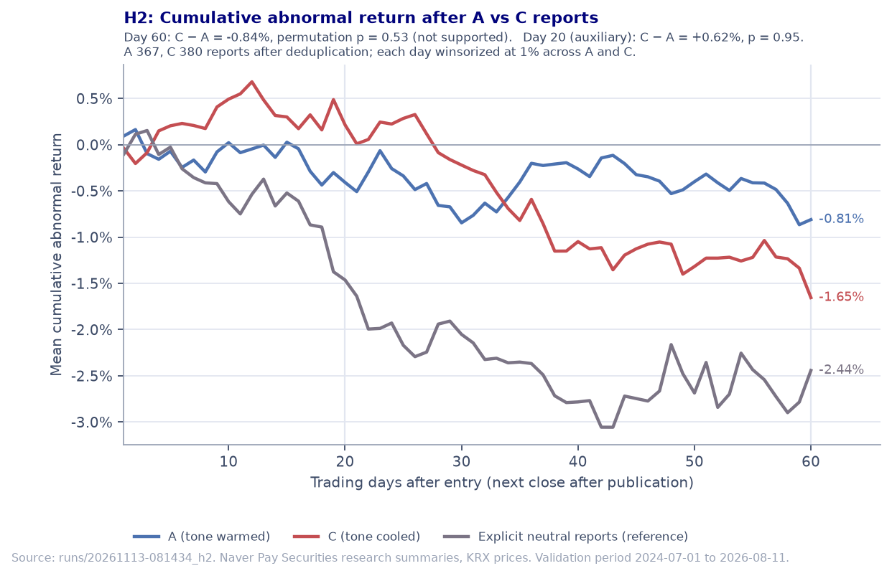
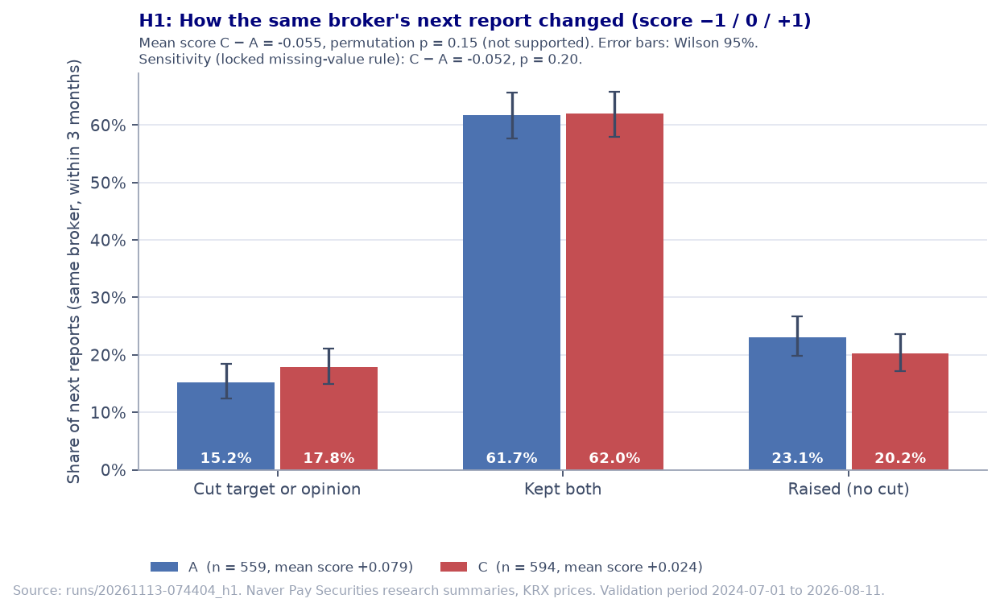
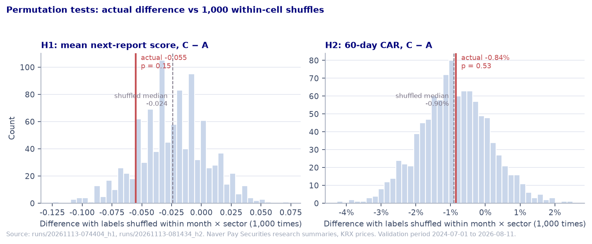

### Backtest (60-trading-day holding, 2024-07-01 to 2026-11-11)

| Version | Before costs | After costs | Max drawdown (after costs; market: no costs) |
|---|---|---|---|
| Executable (shorts off during the ban) | −1.43% | −12.09% | −13.00% |
| Hypothetical (ban ignored) | +0.61% | −13.28% | −13.62% |
| Executable, 5% per-stock cap (added after seeing results) | +5.41% | −5.39% | −8.51% |
| Hypothetical, 5% per-stock cap (added after seeing results) | +6.90% | −7.01% | −9.16% |
| Market reference: universe average, equal-weighted | +35.21% | — | −36.82% |

- Before costs, the strategy is within the range of random labels. The A − C spread (long side + short side) is
  +1.93% against a random-label mean of +1.22% (standard deviation 19.7%, 100 runs). With the cap, the hypothetical
  account return of +6.90% compares with a random-label mean of +0.09% (standard deviation 8.69%). Costs then make it negative.
- **Wind-down.** No new signals arrive after the last validation report (2026-08-11), so holdings shrink to one or two
  stocks near the end and each one carries up to half the account. This moved the account by about −9.5 pp in the
  last nine trading days. The 5% per-stock cap version was added after seeing this, as a diagnostic; the uncapped
  rows remain the main result.
- 20-day and next-report holding periods give the same picture (see `runs/20261113-230018_backtest/backtest.md`).

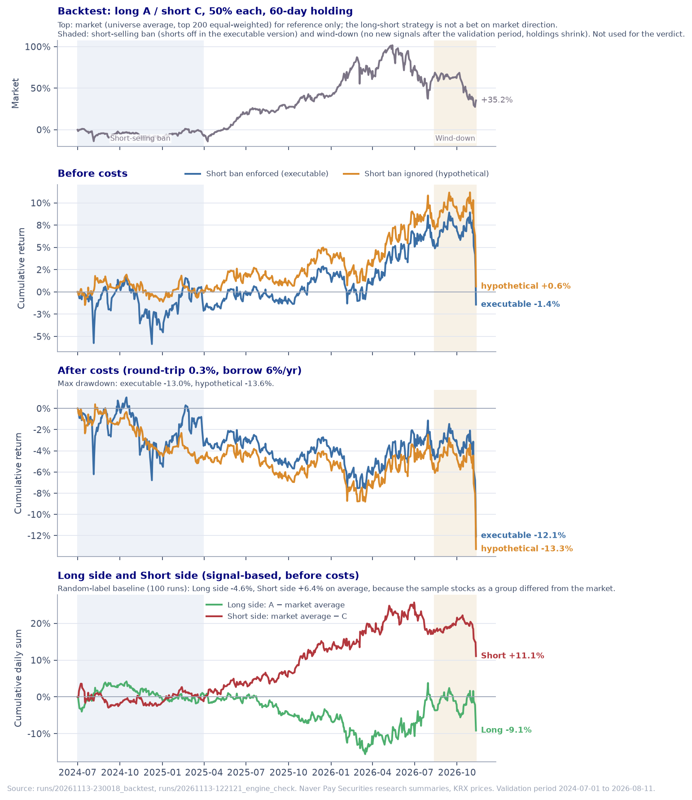
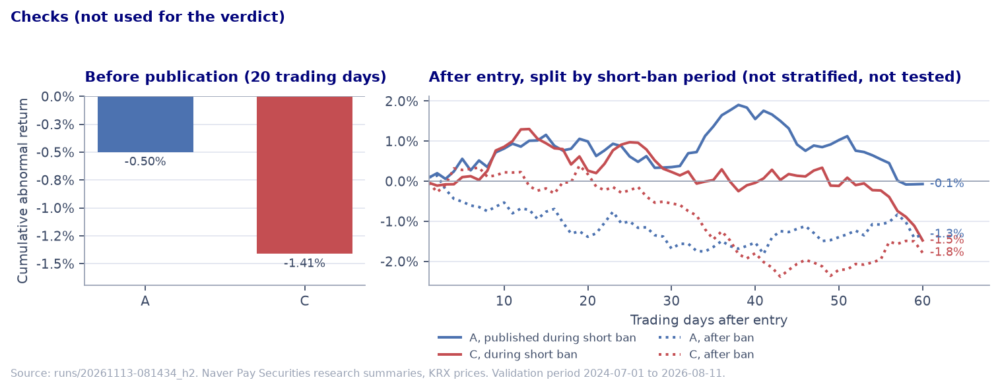
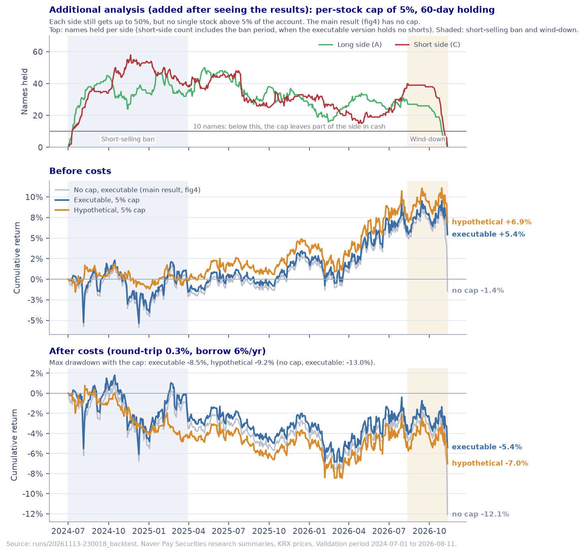

## How the results were protected

- Preprocessing, the tone formula, the cutoffs and the tests were fixed before H1 and H2 were computed, and judged once.
- The cutoffs are locked in `models/cutoffs.json` (git tag `classification-lock`). Code that reads results or real
  grades calls `require_lock()` first and stops if the file is missing; `lock()` refuses to overwrite it.
- Every run writes `runs/<timestamp>_<kind>/` with a copy of the config, the cutoffs, the git commit and the results.

**Deviations from the plan, all disclosed:**

1. The H1 rule for a next report without a target price or opinion was changed after the lock but before H1 was
   computed; the original locked rule was missed when making the change. Both are reported (above), with the same conclusion.
2. The p-value formula was changed to (k + 1) / (n + 1) after the lock. This can only make p slightly larger.
3. The backtest engine was built after H1 and H2 were known (the plan put it before the lock). The engine check was still
   passed before any real-grade backtest. Its first criterion (random-label mean near zero) failed; because that
   criterion also fails a correct engine by chance, it was replaced by the exact A/C swap check before real grades
   were run. The failed record is kept in `runs/`.
4. The 5% per-stock cap and the market reference were added after seeing the backtest.

## Discussion (post hoc)

This section was written **after** seeing the results. None of these explanations was tested, and testing them on the
same data would not be a fair test. They are leads for future work, not findings.

1. **Tone may follow prices rather than lead them.** Three observations fit together. Before publication, C stocks
   had already fallen more than A stocks (−1.41% vs −0.50% over 20 trading days). In the first 20 days after entry,
   C stocks did *better* than A stocks (+0.62 pp, in the upper ~5% of shuffles), which looks like the familiar
   short-term rebound after a drop. By day 60, the remaining gap (−0.84 pp) is what the month × sector mix alone
   produces (−0.90 pp). If analysts write cooler text *after* a price fall, the tone records news the market already knows.
2. **The measurement is noisy.** In the baseline, tone change between two consecutive Buy-and-same-target reports has a
   standard deviation of 0.51 on a −1 to 1 scale. Summaries are only a few sentences, so a change of topic (an earnings
   preview vs. an event note) can move the tone a lot. When part of each grade is noise, any true effect is pulled toward zero.
3. **The sample may be too small for an effect this size.** A one-sided p of 0.15 puts the actual H1 gap about one
   standard deviation from the centre of the shuffle distribution. If a true effect of that size exists, detecting it
   with 80% power would need roughly six times the sample, or more than a decade of data at the current pace.
4. **A hidden sell view may show up elsewhere.** Stocks with explicit Neutral reports did worst of all (−2.44% at day 60;
   a reference line, not tested). Analysts turning negative may downgrade to Neutral or simply stop raising the target,
   and the "maintained twice" sample excludes those cases by design.
5. **Why A stocks and random labels also lagged the market.** In the 2025–2026 rally, analysts raised targets for stocks
   that rose. Stocks whose target stayed the same twice were more likely the laggards, which fits the negative
   pre-publication returns of both groups and the random-label long side (−4.57%). This affects A and C alike, so it
   does not bias C − A.
6. **No sign that the short-selling ban slowed bad news.** The theory predicts C drifting down after entry during the ban
   and staying flat after it. Figure 5 shows roughly the opposite: during the ban the gap came mostly from A rising and
   falling back, while after the ban C drifted down from about day 20 to day 43. The split halves the sample and does
   not control for month × sector, so this is only an observation.
7. **The backtest loses because costs are certain and the edge is not.** Before costs, results sit inside the
   random-label range; trading costs and borrow fees (about 11–14 pp over the period at 60-day holding, more at 20-day
   holding because positions turn over three times as often) are paid regardless.

## v2: the same test with the PDF body

The biggest limitation of v1 was that it read only the title and Naver's short summary. v2 repeats the study on the
same pairs with the title plus the **full PDF body**, and keeps every other rule. It was planned and locked the same
way before its results were computed. Because the outcome data (next reports, returns) had already been seen in v1,
the verdict threshold is halved to **p < 0.025** (Bonferroni for a second attempt on the same outcomes).

| Item | v2 |
|---|---|
| Text | Title + PDF body, extracted with [pdfminer.six](https://github.com/pdfminer/pdfminer.six) layout analysis so that side-by-side tables and prose stay apart. The Naver summary is not used (it mostly repeats the first page) |
| Cleaning | Drop lines that are mostly digits and symbols (≥ 50%) or short without a sentence end (< 10 Korean characters); drop sentences that appear in ≥ 20 different reports (disclaimers, rating definitions, templates); then the v1 preprocessing |
| Sample | The v1 pairs minus those with a report whose PDF has no extractable Korean text: 262 of 4,952 PDFs, all from one broker (Mirae Asset, 73% of its reports; the body is embedded as images). 1,153 baseline and 1,982 validation pairs remain (6.3% fewer) |
| Text volume | Median 29 sentences per report after cleaning (v1: about 7) |
| Cutoffs | Re-fit on the v2 baseline: A > 0.08542, C < −0.08017 (`models/cutoffs_pdf.json`, git tag `classification-lock-pdf`). Validation grades: A 654, B 664, C 664 |
| Same-pairs comparison | v1 grades recomputed on the v2 pairs only, to separate "different text" from "different sample". Reference, no verdict |

### v2 results: not supported

| | v1, all pairs | v1 grades, v2 pairs | v2 (PDF body) |
|---|---|---|---|
| H1: mean score C − A | −0.055 | −0.047 | −0.060 |
| &nbsp;&nbsp;explained by month × sector mix | −0.024 | −0.032 | −0.012 |
| &nbsp;&nbsp;within-cell remainder | −0.031 | −0.015 | −0.049 |
| &nbsp;&nbsp;permutation p | 0.151 | 0.334 | 0.052 |
| H2: 60-day CAR C − A | −0.84 pp | −1.43 pp | +0.01 pp |
| &nbsp;&nbsp;explained by month × sector mix | −0.90 pp | −1.30 pp | −0.03 pp |
| &nbsp;&nbsp;permutation p | 0.53 | 0.45 | 0.52 |
| Verdict | Not supported (p < 0.05) | Reference only | Not supported (p < 0.025) |
| Backtest, executable, 60 days (before / after costs) | −1.43% / −12.09% | — | −6.96% / −17.01% |

"Explained by month × sector mix" is the median gap when labels are shuffled within posting month × sector cells,
i.e. what timing and sector alone produce. The within-cell remainder is the actual gap minus that.

- **Both hypotheses remain unsupported.** Reading the whole report did not reveal a hidden sell signal.
- **H1 moved the expected way, but not past the threshold.** On the same pairs, the part of the gap that month × sector
  cannot explain grew from −0.015 (v1 grades) to −0.049 (v2 grades), and p fell from 0.33 to 0.052. Body tone may carry
  a little more information about the same broker's next revision than the summary does. This is an observation, not
  a finding: the threshold was set in advance and was not met.
- **H2 did not move.** v1's C − A gap was almost entirely month × sector mix. v2 grades are less concentrated in
  particular months and sectors, and within the same cell A and C stocks earned the same. As in v1, C stocks had
  already fallen more before publication (−1.14% vs −0.28% over the previous 20 trading days; a check, not tested).
- **Backtest.** The A − C daily sum (long side + short side) is −11.5%, inside the v1 random-label range (mean +1.2%,
  standard deviation 19.7%). The pre-specified 5% per-stock cap version: −3.43% before and −13.29% after costs. The
  market reference is the same as in v1 (+35.21%).

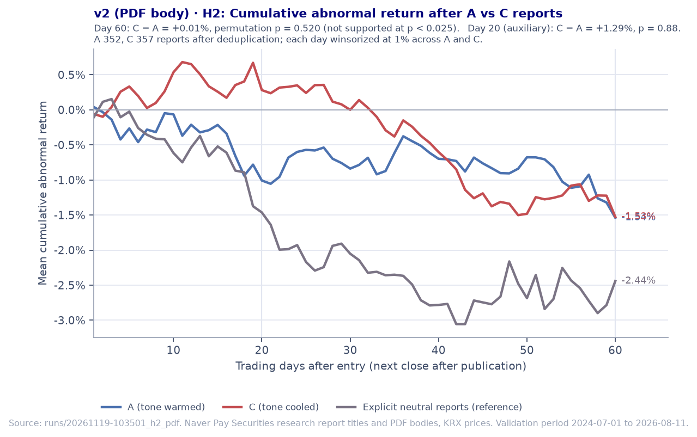
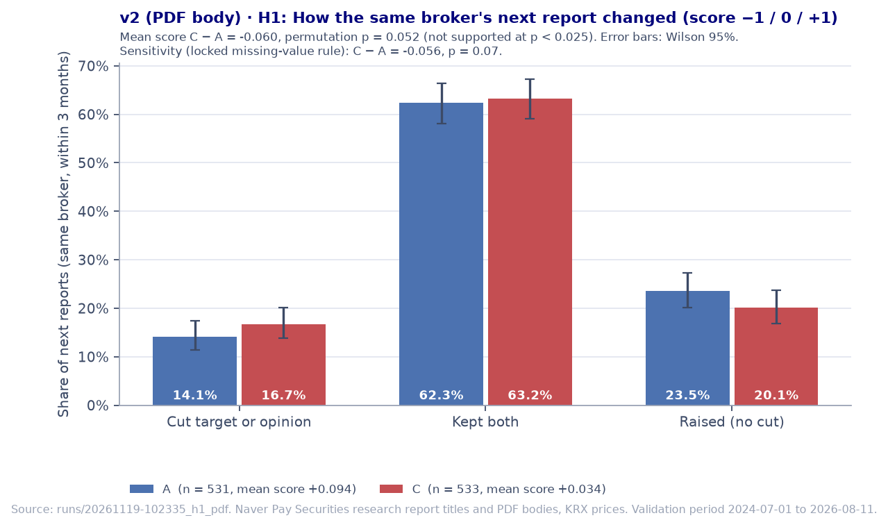
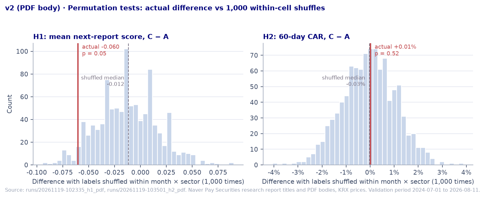
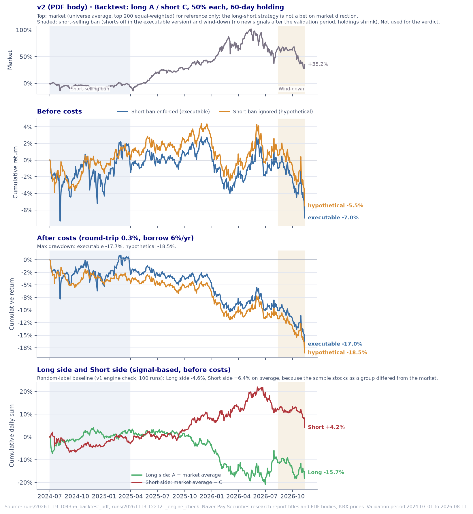
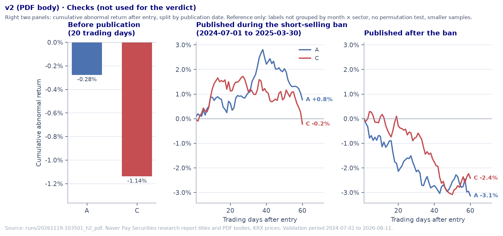
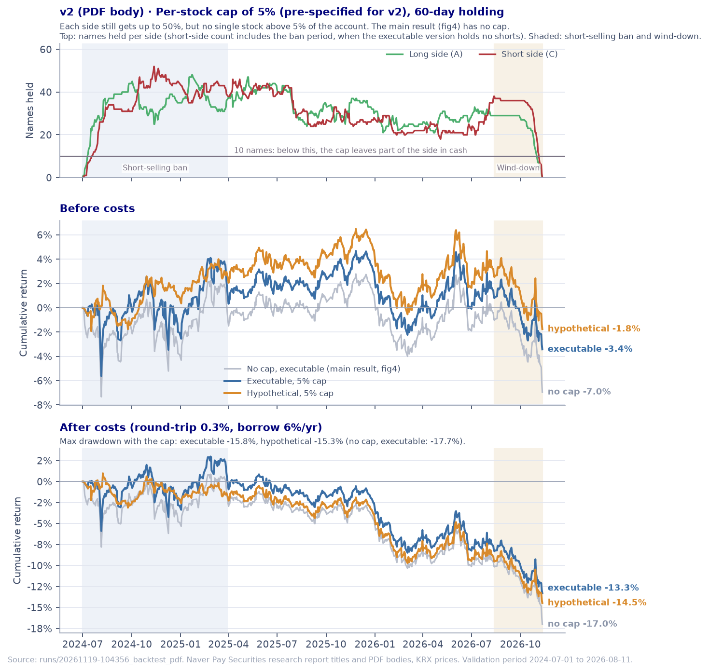

**Decisions made during v2, all before its lock:**

1. More than 5% of pairs dropped because of the image-only PDFs (6.1% baseline, 6.5% validation), which the plan said
   required a new decision. The pairs were dropped; OCR for one broker and filling those pairs with the summary were
   rejected. The same-pairs comparison above was added to show the effect of the smaller sample.
2. The pre-lock check for short texts flagged a concentration because A, B and C all had 0% short pairs (0 ÷ 0 was
   treated as infinite). The rule was clarified to require a share above zero; the first record is kept in `runs/`.

**v2 limitations.** It is a second measurement on outcome data already seen, and its rules were written knowing the
v1 results. One broker is mostly excluded. PDF extraction is imperfect: words broken across lines are joined with a
space, and about 1% of sentences are financial-statement labels that survived cleaning. The model and the absence of
human validation are the same as in v1.

## Limitations

- **No human validation.** Tone scores were not checked against human judgment. The model was trained on general
  financial sentiment, not analyst wording, and may miss conditional or indirect negatives.
- **Title and summary only (v1).** Negative points that appear only in the PDF body are missed. v2 reads the body,
  with its own limitations (see v2).
- **Noisy signal.** Tone change is a difference of two noisy measurements; a report that stays lukewarm shows no change.
- **Smaller sample than planned.** 2,119 validation pairs against an estimate of about 2,800, so the tests have less power.
- **Short window, unusual market.** About 26 months, a third of it under a full short-selling ban, with sharp market drops in 2026.
- **Price trend.** Tone may follow past prices rather than lead them; this is shown (Figure 5) but not controlled for.
- **Correlated reports.** Several brokers covering the same stock at the same time are not independent; H1 counts each broker separately.
- **Name masking is imperfect.** Product, subsidiary and industry terms can still reveal the company or sector.
- **Sector snapshot.** Sectors come from a single KRX snapshot (2026-11-11); seven delisted or merged stocks were assigned by hand.
- **Execution assumptions.** Next-day close fills, 0.3% round-trip cost, 6% borrow. Collateral, recall risk and whether a
  retail investor could borrow the stock that day are not modelled. Only the short-selling ban is enforced in `risk/`.
- **Single classifier, no robustness splits.** No comparison with other models, periods or broker subsets.

## Repository structure

```text
configs/            settings, company aliases, opinion ranks, sector groups
models/            locked cutoffs: cutoffs.json (v1), cutoffs_pdf.json (v2); do not edit
src/
  ingest/           Step 1   Naver reports, KRX prices; 1b PDFs (v2)
  preprocess/       Step 2-4 clean reports, universe, sample pairs, text; 4b PDF text (v2)
  classify/         Step 5-8 sentence tone, tone change, grades and lock
  analysis/         Step 7, 9, 10  pre-lock checks, H1, H2, permutation test
  strategy/         decide(): signal -> target weights (same function for backtest and live)
  risk/             pre-trade check (short-selling ban)
  execution/        order sheet (nothing is sent)
  backtest/         Step 11  engine, engine check, report
  viz/              Step 12  figures
runs/               one folder per run: config copy, commit, results
reports/figures/    figures in this README
tests/              pytest: look-ahead, A/C symmetry, reproducibility, rules
tools/              development dashboard, PDF diagnostics (read data/, not part of the results)
PROGRESS.md         development log (Korean)
```

## How to run

Requires Python 3.13 and a KRX account (pykrx logs in on import). Turn off any VPN while collecting from KRX.

```bash
python -m venv .venv
.venv\Scripts\activate          # Windows; on macOS/Linux: source .venv/bin/activate
pip install -r requirements.txt
```

Create `.env` with `KRX_ID=...` and `KRX_PW=...`. Then run the steps in order. Each step reads the previous step's
files and stops if they are missing.

| Stage | Commands | Step |
|---|---|---|
| Collect | `python -m src.ingest.naver 2023-01 2026-11`<br>`python -m src.ingest.krx 20261111` (last date) | 1 |
| Prepare | `python -m src.preprocess.reports`<br>`python -m src.preprocess.universe`<br>`python -m src.preprocess.pairs`<br>`python -m src.preprocess.text` | 2-4 |
| Tone | `python -m src.classify.tone`<br>`python -m src.classify.change` | 5-6 |
| Pre-lock check | `python -m src.analysis.precheck` | 7 |
| Lock | commit all code, then `python -m src.classify.grade` | 8 |
| H1, H2 | `python -m src.analysis.h1`<br>`python -m src.analysis.h2` | 9-10 |
| Backtest | `python -m src.backtest.verify`<br>`python -m src.backtest.verify --cap`<br>`python -m src.backtest.report` | 11 |
| Figures | `python -m src.viz.figures` | 12 |
| v2 (PDF body) | set `text_source: pdf` in `configs/default.yaml`, then<br>`python -m src.ingest.pdf`<br>`python -m src.preprocess.pdf_text`<br>and Steps 5-12 as above (the engine check is not rerun). Add `--v1same` to the H1 and H2 commands for the same-pairs comparison | 1b-12 |
| Tests | `python -m pytest -q` (no data needed) | — |

All settings (periods, cutoff percentiles, holding days, costs, seeds, model revision, text source) are in
`configs/default.yaml`. With `text_source: pdf`, every step reads and writes files with a `_pdf` suffix and leaves the
v1 files untouched.

## Data and license

- The code is released under the [MIT License](LICENSE).
- **Report titles, summaries and PDF texts are not included.** They are the work of the brokerages that wrote them.
  `data/` (raw and processed data), `.env` and model weights are excluded from the repository; `runs/` holds only
  aggregate numbers.
- The model is downloaded from Hugging Face at revision `f8586286cc3161fb648e9fee09a456069fd846d0` and is not redistributed here.